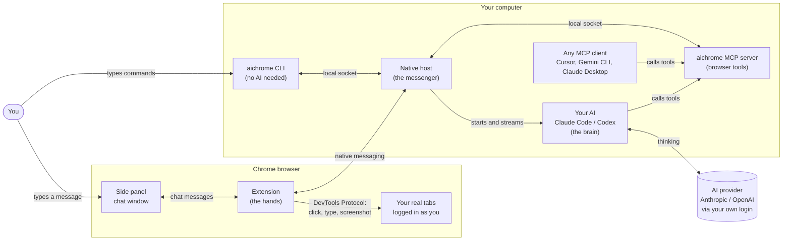
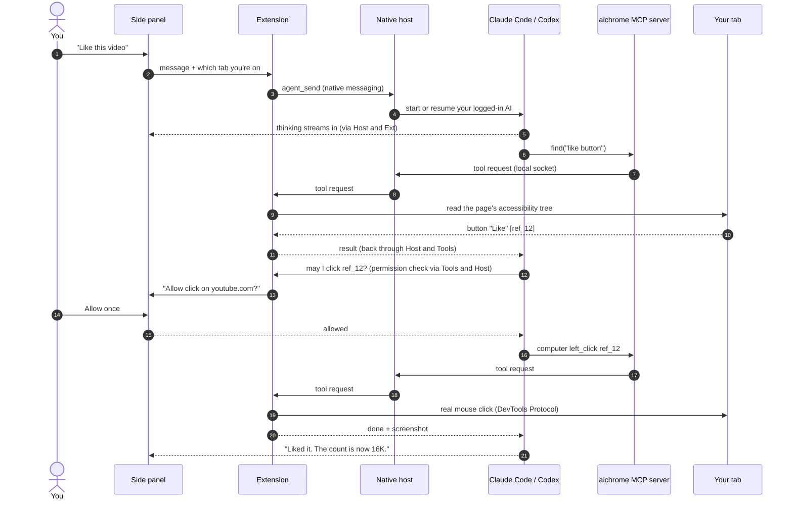
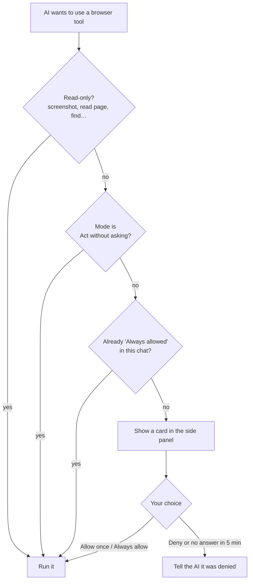

<p align="center"></p>

<h1 align="center">AI in Chrome</h1>

**Claude in Chrome for any AI you already use.** Your terminal AI (Claude Code, Codex, or any MCP client) drives your **real, logged-in Chrome** from a side panel, the terminal, or MCP. No extension login, no API key, no blocked sites, MIT open source.

    

```
side panel / aichrome CLI / any MCP client ──► local bridge (socket or named pipe) ──► native host (started by Chrome) ──► extension ──► DevTools Protocol ──► your tab
```

## Why AI in Chrome

- **Uses the AI you already pay for, or a free local one.** The side panel runs your logged-in Claude Code or Codex, or an open-source model on your own computer through Ollama. No API key, no per-token bill, no separate account for the extension.
- **Your real browser, logged in as you.** It drives the Chrome you're using, with your sessions, cookies and extensions, not a fresh headless profile.
- **Works the way Claude in Chrome does.** Real mouse and keyboard events through the DevTools Protocol, an accessibility tree with `ref_N` element refs, an agent tab group and an on-page indicator showing where the AI acts.
- **No blocked sites, any AI.** No domain blocklist and no vendor lock-in: use Claude, Codex, Cursor, Gemini CLI, Claude Desktop, or no AI at all.
- **Built for developers who debug the web.** Capture traffic with real headers, cookies and tokens; replay or edit requests; mock and rewrite responses live; send requests as the logged-in user; export HAR. An AI can debug your web app end to end, without anyone copying things out of DevTools.
- **Three ways to drive it.** Chat in the side panel, connect any AI over MCP, or type `aichrome` commands yourself.
- **Private and local.** Nothing goes through a server of ours. The bridge only accepts your user account, and only this extension ID can start it.
- **Small, readable, yours.** About 5k lines of plain JavaScript, zero npm dependencies, clean-room code (not copied from Anthropic's extension), MIT licensed.

## Features at a glance

| Area | What you get |
|---|---|
| **Side panel chat** | Claude Code / Codex / Ollama (local models) / Terminal AI picker, streaming answers, thinking blocks, a step timeline with screenshots, plan checklists, permission cards, chat history, image attachments, slash commands, saved prompts, light and dark themes |
| **Browser control** | Tabs, navigation, clicks, typing, keys, scrolling, drag, hover, zoom, screenshots (≤1568 px), form filling, page text, JavaScript |
| **Page understanding** | Accessibility tree with `ref_N` refs (handles `display: contents` and hidden duplicates), `find` by words |
| **Network & debugging** | Full capture with real Cookie and Authorization headers, bodies, WebSocket frames; copy as curl or fetch; replay with edits; `http_request` as the logged-in user (in page, from the extension with no CORS limits, or from Node); cookies incl. HttpOnly; localStorage and sessionStorage; live block, mock, rewrite and delay rules; HAR export; console logs and errors |
| **Files & media** | Upload local files into `<input type=file>` or drop zones (up to 10 MB), drop screenshots onto pages, record annotated GIFs of the AI's actions |
| **Safety** | "Ask before acting" mode with Allow once / Always allow / Deny, read-only actions auto-allowed, a visual indicator on the page, an "AI" tab group |
| **Speed** | Navigation returns at DOM ready (~0.2 s), clicks in ~15 ms, `aichrome run` / `aichrome shell` run many steps in one process |
| **Platforms** | macOS, Linux, Windows 10/11; Chrome, Brave, Edge, Arc, Chromium |

## How it compares

A snapshot from October 2026. See each project for its current state.

| | AI in Chrome | Claude in Chrome (official) | Clones of the official code (claw-in-chrome, claude-for-chrome) | Clean-room rebuilds (open-claude-in-chrome) | Generic MCP browsers (Playwright MCP, Chrome DevTools MCP) |
|---|---|---|---|---|---|
| Chat side panel | ✅ | ✅ | ✅ | ❌ | ❌ |
| AI in the panel | Your Claude Code / Codex login, or local models via Ollama | Claude plan | API key, per token | — | — |
| Any MCP client | ✅ | Claude only | Partly | ✅ | ✅ |
| Your logged-in Chrome by default | ✅ | ✅ | ✅ | ✅ | ❌ separate profile by default |
| Blocked sites | None | Some categories blocked | None | None | None |
| Live mock / rewrite of requests | ✅ | ❌ | ❌ | ❌ | Limited |
| Requests as the logged-in user, HAR export | ✅ | ❌ | ❌ | ❌ | Partly |
| GIF recording | ✅ | ✅ | ✅ | Placeholder only | Video / trace instead |
| CLI without any AI | ✅ | ❌ | ❌ | ❌ | Playwright CLI |
| Open source license | MIT | Closed | Anthropic's code | MIT | Apache-2.0 |

## How it works

### In simple words

Think of it as a **remote control for Chrome** with four parts:

1. **The extension** lives inside Chrome. It's the hands: it clicks, types, scrolls, reads pages and takes screenshots in your real tabs.
2. **The native host** is a small helper program on your computer that Chrome starts by itself. It's the messenger between Chrome and everything outside Chrome.
3. **The AI** is your own Claude Code, Codex or other assistant. It's the brain: it decides what to do next.
4. **You** talk to the AI from the **side panel** in Chrome, from your **terminal**, or you skip the AI and type `aichrome` commands yourself.

When you ask "like this video", the AI reads the page, asks the extension to click the Like button, looks at the result, and tells you it's done. Every step travels through the messenger, and nothing goes through a server of ours.

### The big picture



There are two kinds of traffic:

- **Chat traffic** (side panel only): your message goes from the panel to the extension, then to the native host, which runs your AI in the background. The AI's answer, thinking and steps stream back the same way into the panel.
- **Tool traffic** (side panel, terminal AI, MCP clients and CLI): whenever something wants to act on the browser ("click ref_12"), the request goes through the `aichrome` MCP server or CLI, over a private local socket to the native host, then to the extension, which does it in the tab with the Chrome DevTools Protocol. The result (text or a screenshot) returns along the same path.

### One side panel message, step by step



### Who asks before acting



### The other ways in

| You use… | Path to the browser |
|---|---|
| **Side panel** | Panel → extension → native host → your AI → MCP server → native host → extension → tab |
| **Terminal AI listening to the panel** | Panel → extension → waits until your terminal AI calls `sidepanel_wait` → it acts with the same tools → answers with `sidepanel_reply` |
| **Any MCP client** (Claude Code, Cursor…) | AI → `aichrome mcp` → local socket → native host → extension → tab |
| **CLI, no AI** | `aichrome click ref_1` → local socket → native host → extension → tab |

### The parts

- **Extension** (`extension/`): an MV3 service worker. It runs tools through `chrome.debugger` (CDP): input events, screenshots, JavaScript, console and network. Content scripts build the ref tree and draw the on-page indicator. An offscreen page encodes GIFs with [gif.js](https://github.com/jnordberg/gif.js) (MIT, in `extension/vendor/`). `panel.js` keeps chats, history and permission prompts; `sidepanel.*` is the chat UI.
- **Native host** (`src/host.js`): Chrome starts it via native messaging when the extension loads. It relays tool requests between the extension and a local socket (`~/.ai-in-chrome/bridge.sock`, or a per-user named pipe on Windows), splitting large messages into chunks to fit Chrome's 1 MB limit. For side panel chats it runs your AI in the background (`src/agents.js`) and streams its events back.
- **`aichrome`** (`bin/`, `src/`): the CLI, the MCP server, and local file handling (it reads upload paths and saves GIFs and HAR files).

## Quick start

```bash
git clone https://github.com/AfsalMadathingal/ai-in-chrome.git && cd ai-in-chrome
npm link            # `aichrome` command, zero dependencies
aichrome install    # register the bridge with Chrome / Brave / Edge / Arc / Chromium
```

Then go to `chrome://extensions`, turn on **Developer mode**, click **Load unpacked**, and select `extension/`. Check with:

```bash
aichrome status
```

Full guide, AI client setup and troubleshooting: **[INSTALL.md](INSTALL.md)**.

## Use it yourself (no AI)

```bash
aichrome open example.com            # new tab in the purple "AI" group
aichrome read interactive            # elements with refs:  button "More information…" [ref_1]
aichrome click ref_1                 # click by ref…
aichrome shot -o page.jpg            # …or take a screenshot
aichrome click 640 300               # and click by screenshot pixel
aichrome type "hello"; aichrome key Enter
aichrome fill ref_5 "me@example.com" # inputs, selects, checkboxes
aichrome upload ref_7 ~/cv.pdf       # into <input type=file>, no file picker
aichrome js "document.title"
aichrome record start … aichrome record export -o demo.gif
```

Network debugging, as the logged-in user:

```bash
aichrome network api                 # captured requests:  #12 POST 200 Fetch 1.2 KB 85ms https://…/api/…
aichrome request 12                  # full headers as sent (Cookie, Authorization), bodies, Set-Cookie
aichrome curl 12                     # copy as curl
aichrome replay 12 'body={"id":2}'   # send it again, edited
aichrome http POST https://site/api/x '{"a":1}' -H "X-Debug: 1"   # new request with the browser's cookies
aichrome cookies example.com         # all cookies incl. HttpOnly; also set/delete
aichrome storage                     # localStorage + sessionStorage
aichrome intercept add "*api/user*" mock 'body={"name":"test"}'   # fake a response
aichrome intercept add "*api/*" modify -H "Authorization: Bearer other"  # rewrite requests live
aichrome intercept add "*.js" modify 'replace=[["debug=false","debug=true"]]'  # rewrite responses
aichrome intercept add "*ads*" block; aichrome intercept list; aichrome intercept clear
aichrome har -o session.har          # export for DevTools / Postman / Charles
```

Several steps in one process (fastest):

```bash
aichrome run "open example.com; read interactive; click ref_1"
aichrome shell                       # interactive prompt, or pipe commands in
```

Run `aichrome help` for every shortcut, and `aichrome tools` for every tool and argument.

## Side panel

Click the toolbar icon (or press Cmd/Ctrl+Shift+E) to open a chat panel next to the page. It talks to the AI you already use in your terminal, with no extra login:

- **Claude Code**: runs your logged-in `claude` in the background. It controls the tab through the same tools and asks in the panel before clicking, typing or navigating, unless you pick "Act without asking".
- **Codex**: runs your logged-in `codex` (not yet tested end to end).
- **Ollama**: an open-source model running on your own computer (free, offline, private). Install [Ollama](https://ollama.com), pull a model that supports tools, for example `ollama pull qwen3`, and pick **Ollama** in the panel. It lists your installed models and picks a tool-capable one; you can change the model, and the Ollama address if it runs elsewhere, in Settings. Small models are slower and make more mistakes than Claude or Codex on long tasks; 8B+ models work best.
- **Terminal AI**: an AI already open in your terminal answers the panel. Tell it "listen to the AI in Chrome side panel" and it uses `sidepanel_wait` / `sidepanel_reply` (not yet tested end to end).

Pick the AI from the menu at the top. The panel shows its work as it goes:

- **Thinking:** the AI's reasoning appears in a block you can expand, with how long it thought.
- **Steps:** each browser action is a line in a timeline in plain words ("Click “Sign in” button", "Type “hello” into “Email” field"), with its status and timing, and a one-line summary when the group finishes. A failed step says why right under it. Screenshots appear as thumbnails; click one to enlarge it. Expand a step to see its input and output.
- **Plans:** when the AI makes a to-do list (Claude's TodoWrite or Codex's plan), it appears as a checklist that updates as the work goes.
- **Answers:** Markdown with tables, quotes and code blocks; each code block and answer has a copy button.
- **Permissions:** in "Ask before acting" mode, a card describes the action (for example "Click “Checkout” button", on example.com) with Allow once, Always allow and Deny.

The composer:

- **Images:** paste, drag in, or attach an image, or capture the current tab with the camera button. They are sent to Claude Code or Codex with your message.
- **Voice:** click the mic and speak; your words appear as you talk and a short pause sends them (Esc cancels). Before sending, a separate small model fixes words the recognizer misheard (for example "cloud code" → "Claude Code"), using the page and the chat for context; the changed words animate in, with *use original* and *edit* for a moment before it sends. It uses Chrome's built-in AI (Gemini Nano) when available, otherwise Ollama or a one-shot Claude Haiku; turn it off in Settings → Voice. The first time, a tab opens to allow the microphone, since a side panel can't ask. Speech recognition is Chrome's, which needs an internet connection.
- **Keep chatting while it works:** type while the AI is busy and your message is queued above the box (remove it with ×), then sent as soon as the current task finishes; several queued messages go together. **Send now** stops the current task and sends right away; Esc stops it and puts your queued text back in the box.
- **Slash commands:** type `/` for `/new`, `/history`, `/settings`, `/screenshot`, `/voice`, your saved workflows and your own saved shortcuts (reusable prompts you add in Settings).
- **Permission mode:** the pill next to Send switches between "Ask before acting" and "Act without asking".
- **Stop:** press Esc or the Stop button.

**Workflows: do a task once with the AI, then repeat it without the AI.** When the AI finishes a task, click the bookmark under its reply and name it, or type `/save name` to save every browser step in the chat. Type `/name` to replay it: the extension repeats the clicks, typing and navigation itself, so a replay takes seconds and uses no tokens. Each step remembers the element it used by role and name (the "Sign in" button, the "Email" field), not a position, so it still works after the page reloads or moves things around. If a step can't be done (the page changed), the replay stops and **Let the AI finish** hands only the remaining steps to the AI. Reading and screenshots are left out of a workflow, and typed values are replayed as recorded. Manage workflows in Settings.

For tasks that need judgment each time, `/skill name` asks the AI to write a Claude Code skill (`~/.claude/skills/name/SKILL.md`) with the exact steps, so next time it follows the recipe instead of exploring the page.

**History** (clock icon) lists past chats, grouped by day, with search and delete. **Settings** (gear icon): AI, permission mode, working folder, model, theme (system, light or dark), saved workflows and saved shortcuts. After installing or updating, run `aichrome install` once so the panel can find `claude` / `codex`.

## Use it with AI

**Claude Code**
```bash
claude mcp add --scope user ai-in-chrome -- "$(which node)" "$(pwd)/bin/aichrome.js" mcp
aichrome install-skill               # teaches Claude how to use it well
```

**Other MCP clients:** add a stdio server with command `node` and args `["/path/to/ai-in-chrome/bin/aichrome.js", "mcp"]`. Config snippets for Codex, Cursor, Gemini CLI and Claude Desktop are in [INSTALL.md](INSTALL.md#5-connect-an-ai-optional).

**Any agent with a shell:** it can call `aichrome …` directly.

**AI guide:** [`skills/ai-in-chrome/SKILL.md`](skills/ai-in-chrome/SKILL.md) tells an AI how to install, connect, and drive the browser reliably: refs, uploads, safety with real accounts, and speed tips. Give it to any agent, or install it as a Claude Code skill with `aichrome install-skill`.

## Tools

| Tool | What it does |
|---|---|
| `tabs_context`, `tabs_create`, `tabs_select`, `tabs_close` | List, open (in the AI group), switch and close tabs |
| `navigate` | Go to a URL, or `back` / `forward` / `reload` |
| `computer` | `screenshot`, `left_click`, `right_click`, `double_click`, `triple_click`, `hover`, `left_click_drag`, `type`, `key`, `scroll`, `scroll_to`, `wait`, `zoom` |
| `read_page`, `find` | Accessibility tree with `ref_N` refs; find elements by words |
| `form_input` | Set text fields, selects, checkboxes and radios by ref |
| `get_page_text`, `javascript_tool` | Readable page text; run JavaScript in the page |
| `read_console_messages` | Captured console output, errors and dialogs |
| `read_network_requests`, `network_request` | Captured traffic; one request in full: real headers (Cookie, Authorization), bodies, Set-Cookie, WebSocket frames, or as curl/fetch |
| `http_request` | Send or replay a request as the logged-in user: inside the page, from the extension (no CORS), or from Node (any header, browser cookies attached) |
| `cookies` | Get, set, delete cookies, including HttpOnly |
| `network_intercept` | Live rules: block, mock responses, modify requests (URL, method, headers, body) and responses (status, headers, body, find/replace), add delay |
| `network_export` | Export captured traffic as HAR |
| `file_upload`, `upload_image` | Local files or screenshots into file inputs or drop zones (10 MB max) |
| `gif_creator` | Record actions and export an annotated GIF |
| `resize_window`, `cdp_command`, `extension_reload` | Window size, raw DevTools Protocol, reload the extension |

## Security

- The socket `~/.ai-in-chrome/bridge.sock` is `0600` inside a `0700` folder, so only your user account can drive the browser. On Windows, the bridge is a per-user named pipe; other standard accounts can't connect, but administrators can.
- Chrome only allows the extension ID in the host manifest (`nknkkmpocjbicnfhkgkgiiemkddajodl`, fixed by the manifest `key`) to start the bridge.
- Nothing leaves your machine. The AI you connect sees what the tools return (page text, screenshots), so only connect AIs you trust with your browser.
- The network tools show **real session cookies and auth tokens** (that's the point, for debugging). Whatever AI you connect sees them too, and HAR exports contain them. Don't paste that output or share HAR files publicly.

## Notes

- While AI in Chrome controls a tab, Chrome shows a "started debugging this browser" bar. That's the `chrome.debugger` API at work.
- Console and network capture start when it first attaches to a tab. Reload the page to capture its first requests. Up to 500 requests per tab are kept; XHR/fetch bodies are kept after load, other bodies only while Chrome still has them.
- Intercept rules belong to a tab and stay active until removed or until the extension reloads.
- `chrome://` pages and the Chrome Web Store can't be automated.
- Paste (`cmd+v`) may not work from synthetic input. Use `type` instead.
- After editing extension code: `aichrome reload-extension`. After moving the folder or changing Node: `aichrome install`.
- Logs: `~/.ai-in-chrome/host.log`.
- Platforms: macOS, Linux and Windows 10/11.

## Roadmap

- Benchmark against the official extension and other tools, with results in this README.
- `browser_batch`: several actions in one call, for speed and lower token use.
- A release zip and a demo GIF of the side panel.
- Bookmarks and history tools, an AI-powered `find`, optional human-like input.
- Test Codex mode, Terminal AI mode and Windows on real machines.

Issues and pull requests are welcome.

## License

[MIT](LICENSE)
